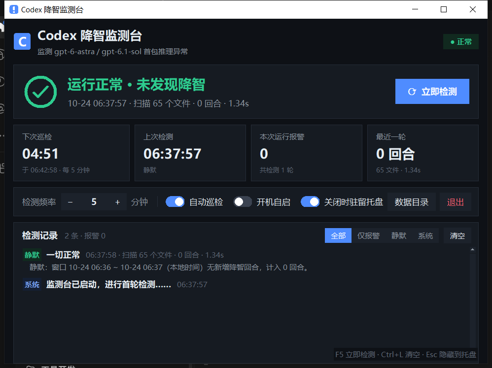

# Codex 降智监测台 · Codex Degrade Monitor

常驻 Windows 托盘的 Codex CLI 降智监测器：自动巡检 + 一键检测，实时告诉你哪些回合被**静默降智**了。



> 判定方法与口径源自 **[pikapikaspeedup/Codexshitdetector](https://github.com/pikapikaspeedup/Codexshitdetector)**，向他致谢 🙏（该仓库未附开源许可证，本项目**未复制其任何代码**，以下所有代码均为独立实现。）

## 为什么需要它

Codex CLI 偶尔会把本该重度推理的回合悄悄路由到降级配置：界面上模型名没变、无任何提示，但代码质量明显下滑，你只能事后花时间收拾 Bug。实测降智是**按回合零散命中**的——同一会话里上一回合正常、下一回合就中招，不盯着每个回合根本发现不了。

本工具直接读 Codex 落盘的会话日志（`~/.codex`），按回合判定并报警，全程本地运行、不联网。

## 判定口径

Codex 把每个用户回合写进 rollout jsonl，只看回合的**第一包** `token_usage_record`：

| 第一包 `reasoning_output_tokens` | 结论 |
|---|---|
| `= 0` | 开场正常 |
| `> 0` | **开场降智**（本轮写出的代码按口径视为可能带 Bug） |
| 用量未落盘，但开口前已出现 reasoning 条目 | 也算降智 |

- 只统计 `gpt-6-astra` / `gpt-6.1-sol`；同一回合后续包、子回合均不计。
- 本地日志里只有请求侧的模型名，**查不到降智后实际服务的模型**——上述行为指纹是本地数据能给出的最强判定。

## 功能

**GUI 常驻监测台**（`codex_watch_gui.py`）

- 托盘常驻：图标**绿色=最近一轮正常，红色=有报警**，报警弹气泡通知 + 提示音
- 检测频率 1~1440 分钟可调（−/+/滚轮），自动巡检随时开关；「立即检测」一键手动
- 每秒刷新的下轮倒计时、上次检测、累计报警、扫描量四张指标卡
- 记录区按 报警/静默/系统/异常 彩色标签展示，可筛选，文字可复制
- 快捷键：`F5`/`Ctrl+R` 立即检测，`Ctrl+L` 清空，`Esc` 隐藏到托盘；支持开机自启
- 独立水位线增量巡检，删掉水位线文件即回看最近 30 分钟

**命令行全量体检**（`degrade_detect.py`）

```bash
python degrade_detect.py                  # 默认最近 7 天：按日/按项目统计 + 逐条明细
python degrade_detect.py --days 3
python degrade_detect.py --since 2026-10-01 --until 2026-10-24
python degrade_detect.py --all            # 全部历史
python degrade_detect.py --model gpt-6-astra
python degrade_detect.py --session 01a16d00   # 单会话逐回合明细（含首包推理 token 数）
```

## 安装与使用

### Windows 免安装（推荐）

到 [Releases](../../releases) 下载 zip，解压后双击 `Codex降智监测台.exe`（`_internal` 目录必须与 exe 同文件夹）。无需 Python。

### 从源码运行

Python 3.9+，tkinter 自带；托盘需要两个可选依赖：

```bash
pip install pystray pillow
python codex_watch_gui.py        # GUI
python degrade_detect.py         # CLI
```

数据文件（配置、水位线、日志）全部生成在程序所在目录，删除即重置。

## 已知限制与踩坑

- **rollout jsonl 的 mtime 不随内容追加更新**（保留会话创建时间戳），不能按 mtime 做增量，只能按文件名日期回看若干天全量解析（每轮约 1~2 秒，后台线程执行不卡界面）。
- 机器休眠/关机期间不巡检；唤醒后下一轮自动补扫整段空窗。
- 会话文件可跨天续聊，回合归属以其自身时间戳为准，文件名日期不代表中招日期。

## 构建与测试

```bash
pip install pyinstaller pystray pillow
py -m PyInstaller --onedir --noconsole --clean -y --name CodexDegradeMonitor ^
    --icon <绝对路径>/assets/app.ico --hidden-import pystray.backends.win32 codex_watch_gui.py
```

注意：`--icon` 必须给**绝对路径**（相对路径会被拼到 spec 目录下）。

```bash
python codex_watch_gui.py --selftest   # 无人自检：跑一轮检测写 selftest_result.txt 后退出
python gui_driver_test.py              # GUI 回归：真实起窗+托盘，验证首轮与手动检测
```

## 致谢

- **[pikapikaspeedup/Codexshitdetector](https://github.com/pikapikaspeedup/Codexshitdetector)** —— 降智判定方法与口径的原创者，本项目的出发点。
- 界面 v2（深色主题重构）由 Claude 完成；检测引擎、CLI、打包与测试链路由 ZCode (GLM) 实现。
- 项目发起与产品决策：Houraiji9。

## License

本项目代码以 [MIT](LICENSE) 授权；上游 Codexshitdetector 保留其所有权利。
